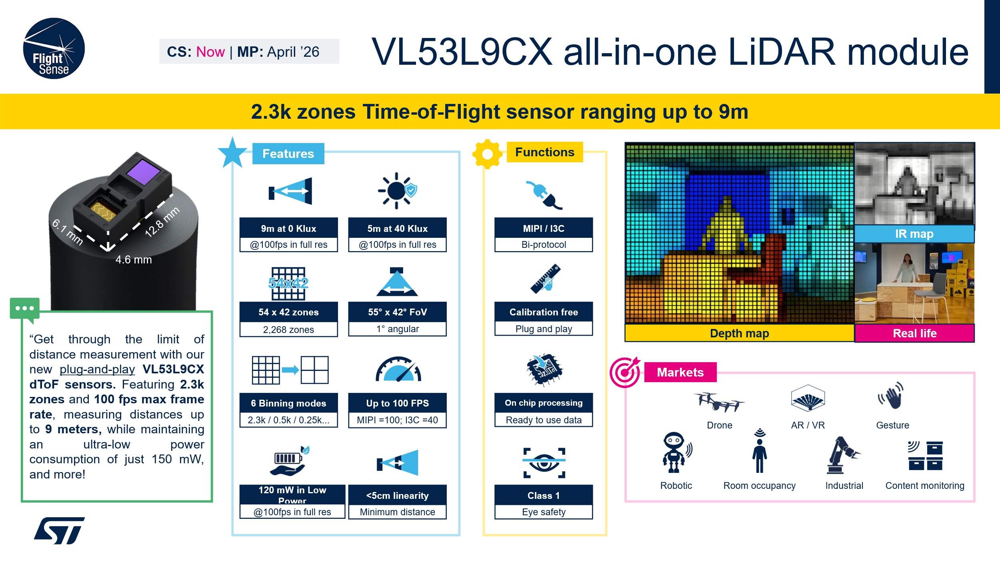
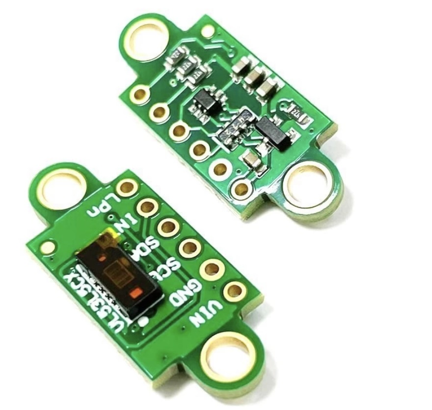

# Project overview

This is not for LLMs to read, just information for humans. What ToF LIDAR should we use for 3D object detection? The following is a little pricy:

## VL53L9CX from ST Electronics

Locally **3,600,000 VND!**

## VL53L5X V2

But his has only 45 degrees and 8x8 = 64 sensor points. Enough? But only **320,000 VND!**

